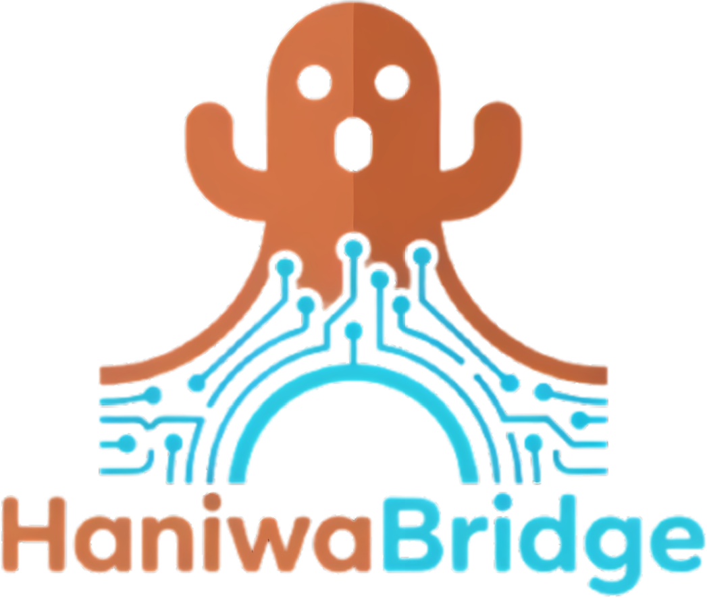
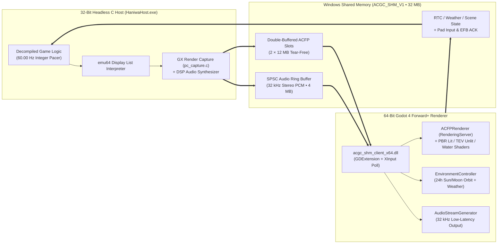

<p align="center">
  
</p>

<h1 align="center">HaniwaBridge — ACGC Godot Hybrid Engine</h1>

<p align="center">
  <a href="https://github.com/jaluraDEV/haniwa-bridge"></a>
  <a href="https://godotengine.org/"></a>
  <a href="#%EF%B8%8F-legal-notice--byo-rom-policy"></a>
</p>

<p align="center">
  <b>Native x86 GameCube Decompilation Host + 64-Bit Godot 4 Forward+ (Vulkan) Renderer via Lock-Free Shared Memory</b>
</p>

---

**HaniwaBridge (ACGC Godot Hybrid)** is an experimental, open-source hybrid engine that pairs the native x86 C decompilation of *Animal Crossing* (GameCube, `GAFE01_00`) with a **64-bit Godot 4 Forward+ (Vulkan) renderer** via a lock-free Windows Shared Memory (`ACGC_SHM_V1`) bridge.

All original gameplay logic, physics, collision, NPC schedules, and memory card (`.gci`) saves run deterministically at 60.00 Hz in the native C host, while Godot 4 replaces the legacy GameCube GX graphics and audio pipeline with real-time dynamic sun/moon lighting, cascaded directional shadows, custom PBR water shaders, and 32 kHz stereo PCM audio streaming.

---

## ⚖️ Legal Notice & BYO-ROM Policy

> [!IMPORTANT]
> **This repository contains zero Nintendo assets, ROM images, textures, models, audio files, or proprietary SDK code.**
> - To build or run this project, you must provide your own legally dumped copy of **Animal Crossing (USA Rev 0 / `GAFE01_00`)** in `.iso`, `.gcm`, or `.ciso` format.
> - On first launch, the **HaniwaBridge Launcher** validates your ROM (`GameID: GAFE01`, `Revision: 0`) and performs a **one-time local extraction** into `orig/GAFE01_00/` (which is strictly gitignored).
> - Never commit, upload, or distribute extracted assets, `.iso` files, or `.acfp` frame captures.

---

## ✨ Key Features

- **1-Click Autonomous Builder & ROM Extractor (`HaniwaLauncher.exe`)**:
  - Automatically compiles the 32-bit headless C host (`HaniwaHost.exe`) locally from source on first launch (no manual command-line building required).
  - Drag-and-drop or select your GameCube USA ROM (`GAFE01_00`) for one-time local extraction.
  - Persistent status verification on every launch (`✅ Extracted & Ready` vs. `⚠️ Not Extracted`).
  - Direct one-click game launch — no `.bat` scripts or mounted ISO required after initial extraction.
- **Dual-Process 32-Bit / 64-Bit Shared Memory Architecture (`ACGC_SHM_V1`)**:
  - **32-Bit Headless C Host (`HaniwaHost.exe`)**: Executes the decompiled GameCube game code with original 32-bit pointer ABI compatibility at an integer-paced 60.00 Hz.
  - **32 MB Lock-Free IPC (`Local\ACGC_SHM_V1`)**: Double-buffered 12 MB `ACFP` (Animal Crossing Frame Packet) slots, 4 MB SPSC lock-free audio ring buffer (100 ms target cushion), real-time state block (RTC, weather, season, scene ID), and reliable sequence-numbered EFB copy handshakes.
  - **64-Bit Godot 4 Forward+ Client (`acgc_shm_client_x64.dll` + GDScript)**: Unrestricted 64-bit address space and VRAM for modern Vulkan rendering, shader caching, and high-resolution shadow maps.
- **Dynamic Real-Time Lighting & Retro Parity**:
  - **Enhanced Lit Mode**: Continuous 24-hour sun and moon orbital mechanics synchronized with your real Windows system clock (RTC), 4-phase atmospheric color profiles (Dawn, Zenith, Golden Hour/Sunset, Moonlight), weather-reactive fog/dimming, and custom tessellated water shaders with shore foam and depth refraction.
  - **Original GameCube Mode (`F4` Toggle)**: Instant, single-key switch back to the unlit GameCube TEV combiner pipeline for 1:1 retro visual comparison.
- **Quality-of-Life Enhancements**:
  - **Native Fast-Start Mode**: Optional native C bypass (`fast_start = 1`) that initializes your save data and transitions straight out of your house into the village, skipping repetitive title/intro dialogue.
  - **Multi-Controller & Native XInput Kernel Bypass**: Simultaneous support for Keyboard, PlayStation (DualSense/DualShock 4), and Xbox Series X|S / One controllers (bypassing Godot 4's Windows USB-C enumeration bug via direct `XInputGetState` polling).

---

## 🏗️ System Architecture



---

## 🚀 Running the Project

1. **Launch the Application**:
   - Run the launcher by running `run_launcher.bat` (or compile the standalone launcher via `tools/build_release_package.ps1`).
2. **One-Time ROM Extraction**:
   - On your first run, the Launcher displays `⚠️ STATUS: NOT EXTRACTED — USA ROM (GAFE01_00) Required`.
   - Click **[ Select USA ROM (.iso/.ciso/.gcm) & Extract ]** and choose your *Animal Crossing (USA Rev 0, GAFE01_00)* disc image.
   - Wait ~2 seconds for extraction to complete. The status indicator will turn green: `● STATUS: EXTRACTED & READY (USA Rev 0 • GAFE01_00)`.
   - On all future launches, the Launcher automatically detects the extracted data in `orig/GAFE01_00/`.
3. **Play**:
   - Configure your preferences (**Fast Start**, **Fullscreen**) and click **[ ▶ Launch Game ]**.

---

## 🎮 Controls & Hotkeys

### Gameplay Controls

| Action | Keyboard (Default) | Xbox Controller (XInput) | PlayStation Controller |
| :--- | :--- | :--- | :--- |
| **Move** | `W` `A` `S` `D` | Left Stick | Left Stick |
| **Camera / C-Stick** | Arrow Keys | Right Stick | Right Stick |
| **D-Pad** | `I` `J` `K` `L` | D-Pad | D-Pad |
| **A Button (Confirm / Interact)** | `Space` | `A` | `Cross (✕)` |
| **B Button (Cancel / Run)** | `Left Shift` | `B` | `Circle (○)` |
| **X Button (Inventory)** | `X` | `X` | `Square (□)` |
| **Y Button** | `Y` | `Y` | `Triangle (△)` |
| **Start Button** | `Enter` | `Start / Menu` | `Options` |
| **L / R Triggers** | `Q` / `E` | `LT` / `RT` | `L2` / `R2` |
| **Z Trigger** | `Z` | `RB` | `R1` |

### Engine & Lighting Debug Hotkeys

| Hotkey | Function |
| :--- | :--- |
| **`F4`** | Toggle between **Enhanced Godot Lighting** and **Original GameCube Unlit Mode** |
| **`F7`** | Cycle weather override (`Host RTC` → `Clear` → `Rain` → `Snow` → `Cherry Blossoms`) |
| **`F8`** | Toggle Directional Shadow Mode (`4-Split PSSM Cascades` ↔ `Orthogonal`) |
| **`[` / `]`** (or `PgUp`/`PgDn`) | Scrub virtual time of day backward / forward (±1 hour, hold `Shift` for ±15 min) |
| **`Backspace` / `\`** | Reset time of day to live Windows system clock (RTC) |
| **`F10`** | Capture single `.acfp` frame snapshot to `captures/` (local debugging) |

---

## 🛠️ Building from Source (Windows)

### Prerequisites

1. **[MSYS2](https://www.msys2.org/)** installed at `C:\msys64` (or `C:\Users\<user>\msys64`).
   Install both 32-bit (for the GameCube C host) and 64-bit (for the Godot GDExtension) toolchains:
   ```bash
   pacman -S --needed \
     mingw-w64-i686-gcc mingw-w64-i686-cmake mingw-w64-i686-ninja mingw-w64-i686-SDL2 \
     mingw-w64-x86_64-gcc
   ```
2. **Godot Engine 4.3+ (Standard 64-bit Windows build)** (`Godot_v4.x-stable_win64.exe` placed in project root or `PATH`).
3. **Python 3.10+** (for build and verification scripts).

### Step 1: Build the 64-Bit GDExtension Client (`acgc_shm_client_x64.dll`)

From an **MSYS2 MINGW64** shell (or PowerShell with `mingw64/bin` in `PATH`):
```bash
./tools/build_client_x64.sh
```
This compiles `bridge/src/acgc_shm_client.c` into `godot/bin/acgc_shm_client_x64.dll` with static MinGW runtime linkage.

### Step 2: Build the 32-Bit Headless Host (`HaniwaHost.exe`)

You can build the host with 1 click using the autonomous builder:
```powershell
# Autonomous 1-click build (automatically finds MSYS2 / MinGW32):
powershell -ExecutionPolicy Bypass -File tools/build_host.ps1
# Or double-click tools/build_host.bat in Windows Explorer
```

*(Alternatively, to build manually via standard CMake/Ninja):*
```powershell
$env:PATH = "C:\msys64\mingw32\bin;C:\msys64\usr\bin;" + $env:PATH
mkdir -Force port/pc/build32 | Out-Null
cd port/pc/build32
cmake -G Ninja ..
ninja
bash -c "find CMakeFiles/ac_pc.dir -name '*.obj' > objects.rsp && ar rcs libacgc_port.a @objects.rsp && rm -f objects.rsp"
cd ../../..
bash -c "gcc -m32 -O2 -static-libgcc -static-libstdc++ -Wl,--large-address-aware -Wl,--disable-dynamicbase -Wl,--allow-multiple-definition -Ibridge/include -Iport/pc/include -Iport/include bridge/src/acgc_host.c bridge/src/acgc_api_impl.c -Lport/pc/build32 -Wl,--start-group port/pc/build32/libacgc_port.a port/pc/build32/libglad.a -Wl,--end-group -lSDL2 -lopengl32 -lwinmm -limm32 -lversion -lsetupapi -lkernel32 -luser32 -lgdi32 -lshell32 -lole32 -loleaut32 -luuid -lcomdlg32 -ladvapi32 -lstdc++ -o HaniwaHost.exe"
```

### Step 3: Run or Export the Launcher

- **Run directly via Godot**:
  ```powershell
  .\Godot_v4.7.2-stable_win64.exe --path godot
  ```
- **Build standalone release package (`dist/HaniwaLauncher.exe`)**:
  ```powershell
  powershell -ExecutionPolicy Bypass -File tools/build_release_package.ps1
  ```

---

## 📁 Repository Structure

```text
.
├── bridge/                  # C/C++ IPC & GDExtension Bridge
│   ├── include/             # ACFP packet format (acgc_frame_packet.h) & C API headers
│   └── src/
│       ├── acgc_host.c      # 32-bit headless producer + ROM extractor CLI (--extract-rom)
│       ├── acgc_api_impl.c  # Host lifecycle, tick step, RTC & state queries
│       └── acgc_shm_client.c# 64-bit GDExtension consumer + native XInput polling
├── godot/                   # 64-bit Godot 4 Forward+ Project
│   ├── launcher/            # Standalone ROM Extractor & Game Launcher UI (launcher.tscn/.gd)
│   ├── renderer/            # ACFPRenderer (RenderingServer mesh/material cache, EFB copy)
│   ├── lighting/            # 24h Sun/Moon orbital controller & atmospheric profiles
│   ├── shaders/             # acgc_lit.gdshader, acgc_unlit.gdshader, acgc_water.gdshader
│   └── shm_main.gd          # Main 60 Hz SHM consumer loop, audio generator & input fusion
├── port/                    # Fork of ACGC-PC-Port (built on ACreTeam/ac-decomp)
│   ├── include/acgc_shm.h   # ACGC_SHM_V1 32 MB shared memory specification
│   └── pc/src/              # GX capture (pc_capture.c), disc/ROM extractor (pc_disc.c), audio
├── tools/                   # Build scripts, asset audit (verify_clean.py), replay tools
└── docs/                    # Technical specifications, benchmarks, and architecture history
```

---

## 🚧 Known Limitations & Open Roadmap (Contributions Welcome!)

This project was built rapidly as an open-source research foundation and welcomes community contributions:

1. **Offscreen Acre Shadow Streaming (In Progress)**:
   - Because the original GameCube engine only keeps a $2 \times 2$ window of acres (`mFM_VISIBLE_BLOCK_NUM = 4`) active in the `BG_ITEM` draw tables, crossing an acre boundary can cause offscreen tree/rock shadows from adjacent acres to pop in or out.
   - **Solution Design**: A dedicated `ACFP_PASS_SHADOW_ONLY` shadow-pass extension is designed to stream adjacent offscreen acres directly from the PC host into the Godot shadow cascades.
2. **Linear Vulkan vs. Integer GameCube TEV Alpha Blending**:
   - In `F4` Original Mode, 5 of 13 benchmark scenes achieve >98% pixel parity (SSIM up to 0.9986). The remaining 8 scenes exhibit minor alpha-blending gamma differences between linear Vulkan blending and 8-bit integer GameCube TEV blending (planned fix: $\alpha' = 1 - (1-\alpha)^{2.2}$).
3. **Upcoming Features**:
   - Full SDFGI / Global Illumination preset tuning (`docs/gate_6_2_prep.md`).
   - Dolphin-compatible HD Texture Pack replacement in the Godot renderer.

---

## 🙏 Credits & Acknowledgments

- **[ACreTeam / ac-decomp](https://github.com/ACreTeam/ac-decomp)**: For the monumental decompilation of *Animal Crossing* (GameCube).
- **[flyngmt / ACGC-PC-Port](https://github.com/flyngmt/ACGC-PC-Port)**: For the x86 PC port foundation and runtime asset offset loader.
- **[Godot Engine](https://godotengine.org/)**: For the 64-bit Forward+ Vulkan rendering engine.

---

## 📄 Trademark Notice & Disclaimer

*Animal Crossing* and *Nintendo GameCube* are registered trademarks of Nintendo Co., Ltd.  
HaniwaBridge is an independent, non-commercial open-source research project and is not affiliated with, endorsed by, or sponsored by Nintendo Co., Ltd. All product names, logos, and brands are property of their respective owners.
