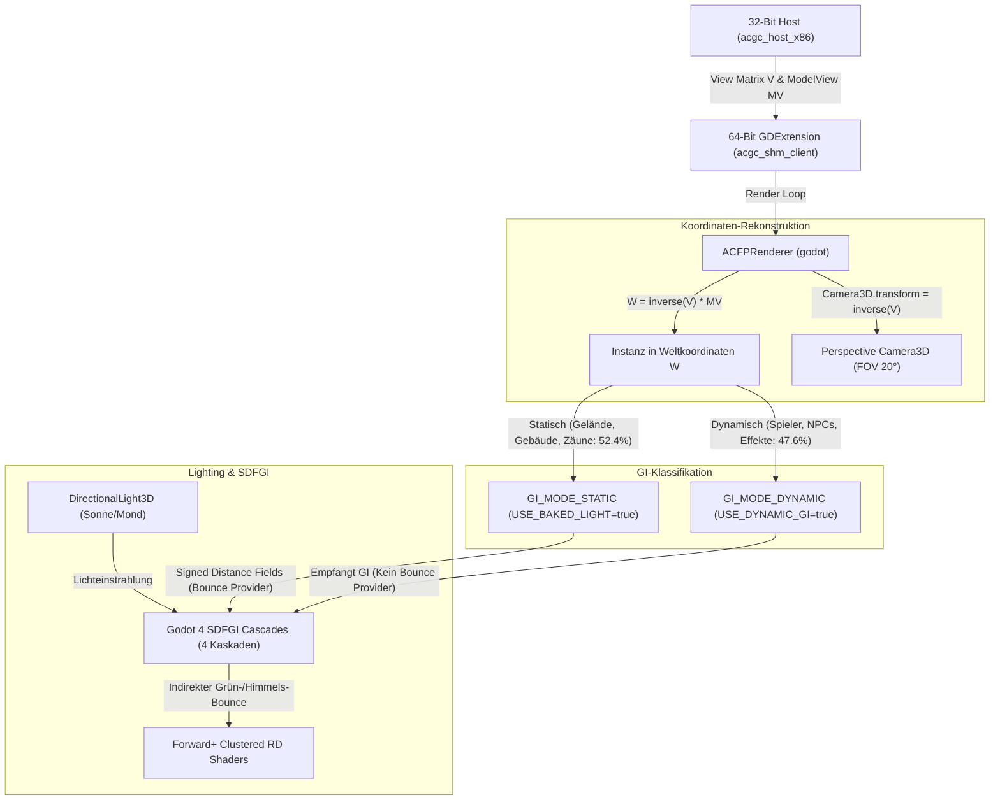

# Vorbereitung Gate 6.2: SDFGI (Erweiterte Godot 4 Forward+ Global Illumination)

**Status**: Schritt 0 (Machbarkeit) erfolgreich verifiziert; Gate 6.2 Umsetzung pausiert bis zur Nutzerabnahme  
**Datum**: 2026-11-03  
**Zielsystem**: NVIDIA GeForce RTX 4060 Laptop GPU (Vulkan 1.4.351, Godot 4.7.2 Forward+ Clustered RD)  
**Beleg-Dokument**: `docs/gate_6_2_feasibility_report.md`

---

## 1. Zielsetzung & Kontext

Nach erfolgreicher Entkopplung in den 64-Bit-Client (Phase 5 / Gate 6.1) und der RTC-getriebenen Sonnen-/Mondbahn (Phase 4.1) besitzt der Godot-Renderer uneingeschränkten 64-Bit-Adressraum und moderne GPU-Hardwarebeschleunigung.

Ziel von **Gate 6.2** ist die Einführung von **Global Illumination (GI)** für realistische indirekte Lichtrückwürfe (Color Bleeding vom Gras auf Fassaden, weiche Verschattung unter Dachvorsprüngen und Zäunen):
- **SDFGI (Signed Distance Field Global Illumination)** für die Außenwelt (Dorf / Scene 7).
- *Innenräume*: VoxelGI ist in Godot 4.7 zwar zur Laufzeit per `VoxelGI.bake()` technisch aufrufbar, wird jedoch aufgrund von Laufzeit-Bake-Stalls (mehrere hundert Millisekunden beim Raumwechsel), 16–64 MB VRAM-Overhead pro Raum und der für ACGC inkompatiblen SceneTree-Node-Traversierung zurückgestellt. Stattdessen wird für Innenräume ein lokales Nahbereichs-SDFGI (`min_cell_size = 0.1`) oder analytisches Indirect-Lighting evaluiert.

---

## 2. Architekturentwurf: SDFGI in der Hybrid-Pipeline

### A. Kamera- & Projektionsmodell
- **Original-Modus (F4 / Unlit)**: Orthografische Dummy-Kamera (`size = 2000.0`), Vertex-Shader berechnet Projektion über `POSITION = u_projection * eyePos` (exakte TEV-Pixelparität).
- **Lit-Modus (Enhanced Lighting)**: Perspektivische Godot `Camera3D` (`PROJECTION_PERSPECTIVE`, `FOV = 20.0°`, `near = 0.1`, `far = 2500.0`). Die Kamera folgt kontinuierlich der inversen View-Matrix $V^{-1}$ des Spiels. Alle Meshes liegen im echten Godot-Weltraum ($W = V^{-1} \cdot MV$).

### B. Geometrie-Klassifikation für SDFGI
In Schritt 0 wurde experimentell bewiesen:
- Objekte mit `GI_MODE_DYNAMIC` tragen **nicht** zum Bounce bei.
- Nur Objekte mit `GI_MODE_STATIC` (`INSTANCE_FLAG_USE_BAKED_LIGHT = true`) speisen Photonen in SDF-Kaskaden ein.
- Daher werden flaches Gelände und statische Strukturen (Häuser, Zäune, Bäume) als `GI_MODE_STATIC` registriert.

### C. Kaskaden-Konfiguration (Perspektivische Abstimmung)
- `sdfgi_cascades = 4`
- `sdfgi_min_cell_size = 0.25`
- `sdfgi_cascade0_distance = 64.0`
- `sdfgi_max_distance = 512.0`
- `sdfgi_y_scale = SDFGI_Y_SCALE_75_PERCENT`
- `sdfgi_use_occlusion = true`
- `sdfgi_bounce_feedback = 0.5`
- `sdfgi_energy = 0.85`

---

## 3. Schutz von Regel 4 (Original-Modus Parität)

> [!IMPORTANT]
> **Kritische Invariante**: Der F4-Original-Modus darf durch SDFGI unter keinen Umständen visuell verändert werden!
> - Beim Umschalten auf Modus 0 (Original TEV) wird `environment.sdfgi_enabled = false` zwingend gesetzt.
> - Der Shader `acgc_unlit.gdshader` ignoriert alle GI-Bindings vollständig (`render_mode unshaded`).
> - Paritätstoleranz aus `docs/scene_parity_13_scenes.md` bleibt garantiert erhalten.

---

## 4. Reales Hardware- & Performance-Budget (Messwerte aus Schritt 0)

| Ressource | Budget-Grenze | Gemessener Wert (Schritt 0) | Status |
|---|---:|---:|:---:|
| **VRAM (SDFGI Kaskaden + History)** | < 800 MB | **498.0 MB** (Zuwachs +371 MB) | **PASS** (RTX 4060 hat 8.192 MB VRAM, 6.1% Belegung) |
| **System-RAM (64-Bit Godot Client)** | < 1000 MB | **153.2 MB** | **PASS** (Kein 32-Bit Limit) |
| **GPU Renderzeit p95 / max (SDFGI)** | < 5.0 ms | **1.58 ms** (Max: 1.64 ms) | **PASS** (> 90% GPU-Headroom) |
| **GPU Renderzeit p95 / max (Lit ohne GI)** | < 3.0 ms | **0.89 ms** (Max: 1.16 ms) | **PASS** |
| **GPU Renderzeit p95 / max (Original F4)** | < 2.0 ms | **0.50 ms** (Max: 0.76 ms) | **PASS** |
| **CPU Renderzeit p95 (Kamerabewegung Dorf)** | < 5.0 ms | **2.73 ms** (Max: 3.43 ms) | **PASS** |
| **GPU Renderzeit p95 (Kamerabewegung Dorf)** | < 5.0 ms | **2.34 ms** (Max: 4.52 ms) | **PASS** |
| **Ortsfeste Geometrie-Stabilität** | < 0.05 Einheiten | **0.0002 Einheiten** | **PASS** (105 Hashes ortsfest über 300 Frames) |

---

## 5. Konkrete Kriterien für Gate 6.2 (Abnahmekatalog)

Ein Bestehen von Gate 6.2 setzt die lückenlose Erfüllung folgender Punkte voraus:
1. **Sichtbarer indirekter Bounce**: Boden und Vegetation reflektieren warmes/farbiges Fülllicht an vertikale weiße Wände (in Schritt 0 an isolierter Fassade mit $\Delta R = +62.8$ LSB spektraler Rot-/Warmverschiebung und an Zäunen mit bis zu $\Delta G = +209$ LSB nachgewiesen).
2. **Dynamische Tag/Nacht-Reaktion**: Bei Nacht wechselt der indirekte Lichtanteil zu kühlem Mondlicht, bei Sonnenuntergang zu warmem Orange.
3. **Strikte F4-Trennung**: Umschalten per F4 deaktiviert SDFGI rückstandsfrei (0 ms GI-Overhead, keine Helligkeitsverfälschung).
4. **Performance-Verifikation**: 3-minütiger Dorf-Rundgang im echten Main-Loop weist ein **p99 < 16.7 ms** (stabile 60 FPS) auf.
5. **Zero Asset Violation**: Keinerlei gebackene Texturkarten oder proprietäre Assets im Git-Repo.
6. **VoxelGI-Zurückstellung**: Innenräume werden primär über SDFGI/analytische Leuchtquellen realisiert; VoxelGI bleibt aufgrund von Laufzeit-Voxelisierungs-Stalls und Szenenbaum-Inkompatibilität zurückgestellt.

---

## 6. Nächste Schritte nach Freigabe

Gate 6.2 startet erst nach expliziter Freigabe durch den Nutzer / Reviewer:
1. Feintuning der Kaskadendistanzen und Blend-Weights für weiche Übergänge.
2. 3-minütiger Dauer-Benchmark mit kontinuierlichem Tag/Nacht-Wechsel.
3. Dokumentation und formaler Gate-6.2-Abschlussbericht.
