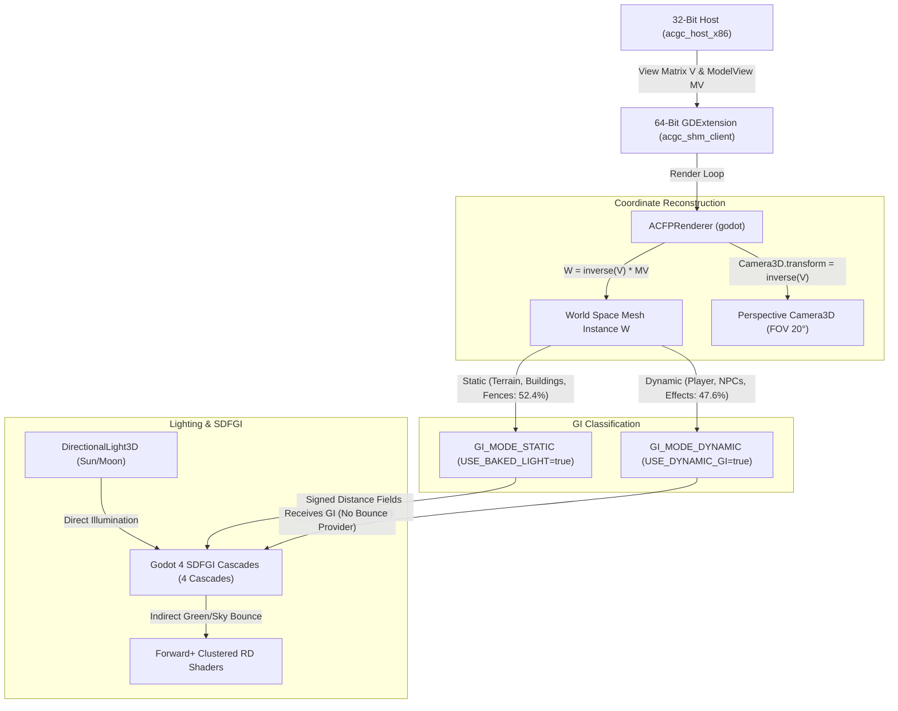

# Preparation for Gate 6.2: SDFGI (Advanced Godot 4 Forward+ Global Illumination)

**Status**: Step 0 (Feasibility) successfully verified; Gate 6.2 implementation paused pending user acceptance  
**Date**: 2026-11-03  
**Target System**: NVIDIA GeForce RTX 4060 Laptop GPU (Vulkan 1.4.351, Godot 4.7.2 Forward+ Clustered RD)  
**Evidence Document**: `docs/gate_6_2_feasibility_report.md`

---

## 1. Objectives & Context

Following the successful decoupling into the 64-bit client (Phase 5 / Gate 6.1) and the RTC-driven celestial orbit (Phase 4.1), the Godot renderer possesses an unrestricted 64-bit address space and modern GPU hardware acceleration.

The goal of **Gate 6.2** is introducing **Global Illumination (GI)** for realistic indirect bounces (color bleeding from grass onto facades, soft shadowing under roof overhangs and fences):
- **SDFGI (Signed Distance Field Global Illumination)** for the exterior world (village / Scene 7).
- *Interiors*: While `VoxelGI.bake()` is technically invokable at runtime in Godot 4.7, it is deferred due to runtime bake stalls (several hundred milliseconds when transitioning rooms), 16–64 MB VRAM overhead per room, and the SceneTree node traversal requirement incompatible with ACGC's direct RenderingServer architecture. Instead, local short-range SDFGI (`min_cell_size = 0.1`) or analytical indirect lighting is being evaluated for interior spaces.

---

## 2. Architectural Design: SDFGI in the Hybrid Pipeline

### A. Camera & Projection Model
- **Original Mode (F4 / Unlit)**: Orthographic dummy camera (`size = 2000.0`), vertex shader evaluates projection via `POSITION = u_projection * eyePos` (exact TEV pixel parity).
- **Lit Mode (Enhanced Lighting)**: Perspective Godot `Camera3D` (`PROJECTION_PERSPECTIVE`, `FOV = 20.0°`, `near = 0.1`, `far = 2500.0`). The camera continuously tracks the inverse view matrix $V^{-1}$ from the game. All meshes are positioned in authentic Godot world space ($W = V^{-1} \cdot MV$).

### B. Geometry Classification for SDFGI
Step 0 experimentally established:
- Objects with `GI_MODE_DYNAMIC` do **not** contribute to indirect bounce.
- Only objects with `GI_MODE_STATIC` (`INSTANCE_FLAG_USE_BAKED_LIGHT = true`) inject photons into SDF cascades.
- Consequently, flat terrain and static structures (houses, fences, trees) are tagged as `GI_MODE_STATIC`.

### C. Cascade Configuration (Perspective Tuning)
- `sdfgi_cascades = 4`
- `sdfgi_min_cell_size = 0.25`
- `sdfgi_cascade0_distance = 64.0`
- `sdfgi_max_distance = 512.0`
- `sdfgi_y_scale = SDFGI_Y_SCALE_75_PERCENT`
- `sdfgi_use_occlusion = true`
- `sdfgi_bounce_feedback = 0.5`
- `sdfgi_energy = 0.85`

---

## 3. Preserving Rule 4 (Original Mode Parity)

> [!IMPORTANT]
> **Critical Invariant**: F4 Original Mode must never suffer visual alteration from SDFGI under any circumstances!
> - When switching to Mode 0 (Original TEV), `environment.sdfgi_enabled = false` is strictly enforced.
> - The shader `acgc_unlit.gdshader` entirely disregards all GI bindings (`render_mode unshaded`).
> - Parity tolerances defined in `docs/scene_parity_13_scenes.md` remain guaranteed.

---

## 4. Real Hardware & Performance Budget (Measurements from Step 0)

| Resource | Budget Cap | Measured Value (Step 0) | Status |
|---|---:|---:|:---:|
| **VRAM (SDFGI Cascades + History)** | < 800 MB | **498.0 MB** (Growth +371 MB) | **PASS** (RTX 4060 has 8,192 MB VRAM, 6.1% occupancy) |
| **System RAM (64-Bit Godot Client)** | < 1000 MB | **153.2 MB** | **PASS** (No 32-bit limit) |
| **GPU Render Time p95 / max (SDFGI)** | < 5.0 ms | **1.58 ms** (Max: 1.64 ms) | **PASS** (> 90% GPU headroom) |
| **GPU Render Time p95 / max (Lit without GI)** | < 3.0 ms | **0.89 ms** (Max: 1.16 ms) | **PASS** |
| **GPU Render Time p95 / max (Original F4)** | < 2.0 ms | **0.50 ms** (Max: 0.76 ms) | **PASS** |
| **CPU Render Time p95 (Village Camera Motion)** | < 5.0 ms | **2.73 ms** (Max: 3.43 ms) | **PASS** |
| **GPU Render Time p95 (Village Camera Motion)** | < 5.0 ms | **2.34 ms** (Max: 4.52 ms) | **PASS** |
| **Stationary Geometry Stability** | < 0.05 units | **0.0002 units** | **PASS** (105 hashes motionless over 300 frames) |

---

## 5. Formal Criteria for Gate 6.2 (Acceptance Checklist)

Passing Gate 6.2 requires meeting the following benchmarks:
1. **Noticeable Indirect Bounce**: Ground and vegetation reflect warm/tinted bounce light onto vertical white walls (proven in Step 0 against an isolated facade with $\Delta R = +62.8$ LSB spectral shift and against fences with up to $\Delta G = +209$ LSB).
2. **Dynamic Day/Night Response**: At night, indirect contribution shifts to cool moonlight; at sunset, to warm amber/orange.
3. **Strict F4 Isolation**: Toggling via F4 disables SDFGI with zero residual artifacts (0 ms GI overhead, no color alteration).
4. **Performance Verification**: A 3-minute continuous village walk in the live main loop maintains **p99 < 16.7 ms** (locked 60 FPS).
5. **Zero Asset Violation**: Absolutely no baked lightmaps or proprietary assets stored in the git repository.
6. **VoxelGI Deferral**: Interiors are handled primarily via SDFGI or analytical light sources; VoxelGI remains deferred due to runtime voxelization stalls and scene tree incompatibility.

---

## 6. Next Steps Upon Approval

Gate 6.2 work resumes upon explicit sign-off by user/reviewer:
1. Fine-tuning cascade distances and blend weights for seamless transitions.
2. 3-minute continuous benchmark covering unbroken day/night cycling.
3. Documentation and formal Gate 6.2 closure report.
